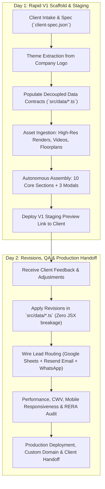

# Luxury Real Estate Microsite Generator (`build-real-estate`)

An autonomous AI agent skill to scaffold, customize, and deliver ultra-premium, high-converting real estate and luxury residence landing pages in a **2-day turnaround cycle**.

---

## ⚡ The 2-Day Agency Delivery Blueprint

When a client requests a landing page for a real estate project (luxury high-rise, residential tower, penthouse collection, or private villa enclave), execute this 2-day protocol:



### Day 1: Build & Deploy Version 1
1. **Intake & Brand Analysis**:
   - Extract primary, secondary, and accent colors directly from the client's provided company/project logo.
   - Configure project metadata, RERA registration number, location, and configurations in `client-spec.json`.
2. **Populate Decoupled Data Contracts**:
   - `src/data/units.ts`: Typologies (1BHK, 2BHK, 3BHK, Penthouses, Villas), carpet area, dimensions, price guidance, floor plans.
   - `src/data/projects.ts` / `siteConfig.ts`: Project narrative, key architectural highlights, amenities, possession timeline.
3. **Stage Visual Assets**:
   - Place architectural exterior renders, interior staging photos, and floor plans into `public/assets/real-estate/` (or Sanity/Cloudinary CDN).
4. **Scaffold the Complete Layout**:
   - Wire the 10 core luxury sections and 3 interactive modal suites into `app/(site)/page.tsx`.
5. **Ship Staging URL**:
   - Push to staging (e.g., Vercel / Netlify) and share the interactive V1 preview with the client for feedback by end of Day 1.

### Day 2: Revisions, Polish & Final Delivery
1. **Incorporate Client Revisions**:
   - Tweak pricing guidance, floor plan specs, copy, and images strictly via the decoupled data files (`src/data/`) without touching component code.
2. **Validate Lead Generation**:
   - Verify multi-destination lead capture: instant Google Sheets spreadsheet logging via webhook and instant email alert via Resend.
   - Test WhatsApp direct chat connection with pre-filled inquiry text.
3. **Execute Production Audit**:
   - Verify smooth scrolling (Lenis/GSAP), image lazy-loading, mobile navigation, and RERA compliance disclaimers.
4. **Deploy & Deliver**:
   - Map client custom domain, verify SSL certificate, and hand over the live website by end of Day 2.

---

## 🏛️ Standard 10-Section Architecture & Flow

Every real estate landing page scaffolded with this skill adheres to the proven, battle-tested section flow:

```
┌─────────────────────────────────────────────────────────────┐
│ 1. LuxuryNavbar (Glassmorphic, Sticky, Brand Logo, VIP CTA)  │
├─────────────────────────────────────────────────────────────┤
│ 2. HeroParallax (Aperture Carousel / Video, Quick Actions)  │
├─────────────────────────────────────────────────────────────┤
│ 3. About Project (Architectural Narrative, Italic Accents)  │
├─────────────────────────────────────────────────────────────┤
│ 4. About Developer (Legacy, Proven Track Record, RERA Badge)│
├─────────────────────────────────────────────────────────────┤
│ 5. ImageGallery (Master GSAP Pinned & Scaled Photo Scroller)│
├─────────────────────────────────────────────────────────────┤
│ 6. AmenityScroller (Curated Lifestyle Cards & Detail Modals)│
├─────────────────────────────────────────────────────────────┤
│ 7. FloorPlanScrubber (Interactive Typology Selector & Zoom) │
├─────────────────────────────────────────────────────────────┤
│ 8. LocationRadar (Neighborhood Distances, Commute Times)     │
├─────────────────────────────────────────────────────────────┤
│ 9. VIP Inquiry Suite (Interactive Visit Scheduler & Forms)  │
├─────────────────────────────────────────────────────────────┤
│ 10. Luxury Footer (Legal Disclaimers, MahaRERA QR & Links)  │
└─────────────────────────────────────────────────────────────┘
  + Floating Suite: BookingModal, BrochureModal, BrandFilmModal
```

### Component Breakdown
1. **`LuxuryNavbar.tsx`**:
   - Floating glassmorphic header (`backdrop-blur-md bg-white/90` or `bg-slate-950/80`).
   - Client logo, clean navigation links (`#about`, `#gallery`, `#amenities`, `#residences`, `#location`), direct phone dialer, and "Schedule Private Viewing" CTA button.
2. **`HeroParallax.tsx`**:
   - Full-bleed aperture carousel (`ApertureCarousel`) with smooth transitions or looping video background.
   - Dynamic room switcher pills (e.g., 1 BHK Suite, 2 BHK Grand, 3 BHK Presidential, Living & Dining Salon).
   - Three instant action triggers: **"Book Private Tour"**, **"Download E-Brochure"**, and **"Cinematic Film"**.
3. **`About.tsx` (Project Narrative)**:
   - Editorial split-screen: evocative architectural narrative on the left, full-bleed high-res render on the right with subtle hover zoom (`hover:scale-105 duration-700`).
   - Key project metrics: Towers, Storeys, Configurations, and Possession Date.
   - Luxury typography with *deliberate italic accents* on emotional hooks (e.g., *Elevated*, *Sanctuary*, *Art of Living*).
4. **`AboutHumDeveloper.tsx` / `AboutDeveloper.tsx` (Developer Legacy)**:
   - Developer credibility builder: years of excellence, square feet delivered, happy families, on-time possession track record.
   - MahaRERA / local RERA registration number and authentic QR code preview.
5. **`ImageGallery.tsx` (Master GSAP Timeline)**:
   - ScrollTrigger pinned stage:
     - *Stage 1*: Headline scales smoothly into view.
     - *Stage 2*: Center hero photo expands to full-screen (100vw x 100vh) while surrounding cards fade away.
     - *Stage 3*: Horizontal scrub carousel across categorized renders (Exterior, Living Salon, Master Bedroom, Sky Terrace) with interactive lightbox modal zoom.
6. **`AmenityScroller.tsx` (Lifestyle Amenities)**:
   - Curated cards (Infinity Pool, Sky Lounge, Wellness Gym, Zen Garden, Children's Play Zone).
   - Opens `AmenityDetailModal.tsx` for deep dive specifications and lifestyle photography.
7. **`FloorPlanScrubber.tsx` (Interactive Residences)**:
   - Typology selector buttons (`1 BHK`, `2 BHK`, `3 BHK`, `Penthouse`, `Villa`).
   - Detailed specification cards: Carpet Area (Sq.Ft. and Sq.M.), Ceiling Height, Balconies, Facing (Vastu / Sea / Greens).
   - High-resolution architectural blueprint lightbox with pan & zoom capabilities.
8. **`LocationRadar.tsx` (Strategic Connectivity)**:
   - Clean radar matrix displaying travel times (Metro 3 mins, International Airport 25 mins, Business District 10 mins, Schools & Malls 8 mins).
   - Embedded Google Maps styling or bespoke minimalist architectural vector map.
9. **`Contact.tsx` (VIP Sales Gallery Suite)**:
   - Interactive appointment scheduler with date picker, unit preference selector, and client phone/email validation.
   - Instant WhatsApp one-tap conversation link with pre-filled message.
   - On-site sales gallery address, directions button, and customer care hotline.
10. **`Footer.tsx`**:
    - Complete regulatory compliance: MahaRERA / state real estate registration number, official project QR code, disclaimers, privacy policy, and copyright.
11. **Persistent Modals**:
    - `BookingModal.tsx`: VIP Private Viewing appointment scheduler drawer.
    - `BrochureModal.tsx`: Instant PDF E-Brochure digital download with phone & email gate.
    - `BrandFilmModal.tsx`: Cinematic full-screen video player modal with sound toggle.

---

## 🎨 Luxury Aesthetics, Minimal Content & Rich Imagery

### 1. Minimal Content, Rich Imagery Rule
- Real estate is sold through **emotion, space, and lighting**, not paragraphs of text.
- Maintain a **75% visual to 25% text ratio**.
- Replace long descriptive blocks with punchy editorial headlines, metadata badges, and large high-resolution photography.
- Imagery must look rich: golden hour natural light, warm dusk lighting with illuminated interiors, architectural symmetry, and macro material textures (Italian marble, brushed bronze, raw travertine stone, floor-to-ceiling glass).

### 2. Editorial Typography & Italic Accents
- **Headings**: Premium serif font (`font-heading`, `font-serif`, `font-editorial` e.g., *Cormorant Garamond*, *Playfair Display*, *Cinzel*).
- **Curated Italic Accents**: Deliberately style 1 or 2 emotional words per headline in an elegant, lighter italic serif:
  ```html
  <h2 className="font-heading text-4xl sm:text-5xl text-slate-900 leading-tight">
    Modern Residences.<br />
    <span className="italic font-light">Elevated</span><br />
    Everyday Living.
  </h2>
  ```
- **Body Text**: Clean, modern, highly readable sans-serif (`font-sans` e.g., *Plus Jakarta Sans*, *Inter*, *Outfit*).
- **Metadata Badges**: Monospace or clean uppercase sans with wide tracking (`text-xs uppercase tracking-[0.25em] font-bold`).

### 3. Dynamic Theming Derived from Company Logo
The color palette must be dynamically adapted from the client's provided brand logo:

| Brand Logo Palette | Primary Accent | Secondary Tone | Background Base | Mood |
| :--- | :--- | :--- | :--- | :--- |
| **Sapphire / Royal Blue** (e.g. Hum Emerald/Sapphire) | `#265CA0` | `#183C68` (Deep Navy) | Crisp White `#FFFFFF` or Ice `#F8FAFC` | Prestigious, trustworthy, modern urban |
| **Bronze / Tuscan Terracotta** (e.g. Mejuma Tuscany) | `#C5A880` | `#38352C` (Espresso Stone) | Warm Linen `#FAF8F5` | Earthy, artisanal, serene timeless luxury |
| **Warm Gold / Champagne** (e.g. Sobha Privy) | `#D4AF37` / `#9B802E` | `#0F0F11` (Obsidian) | Noir Slate `#0B0F17` | High-roller, opulent, dramatic night glamour |
| **Super Minimalist Blanc & Noir** (e.g. MRC Residences) | `#111111` | `#71717A` (Muted Zinc) | Pure White `#FFFFFF` & Off-White `#F4F4F5` | Understated ultra-wealth, gallery quiet luxury |
| **Emerald Forest Green** | `#1B4D3E` | `#0D281E` | Alabaster `#F7F9F6` | Biophilic, sanctuary, sustainable luxury |

#### Universal Luxury Denominators (Common Across All Themes):
- **Image Hover Motion**: Smooth scaling on cards (`transition-transform duration-700 ease-out hover:scale-105`).
- **Hairline Borders**: Understated luxury borders (`border-white/10` in dark mode or `border-slate-200` / `border-black/5` in light mode).
- **Tactile Grain / Textures**: Subtle noise overlay options to convey editorial print texture.
- **Scroll Inertia**: Lenis or GSAP ScrollTrigger smooth inertia scrolling for an effortless float feel.

---

## 🌟 Benchmark References & Design Lessons

Study and mirror these live benchmarks when scaffolding client landing pages:

1. **[Mejuma Tuscany](https://www.mejuma-tuscany.com/)**
   - *Aesthetic*: Tuscan turnkey villa development.
   - *Key Takeaways*: Earthy palette (`#38352C`, `#F1F1F1`), slow cinematic storytelling, elegant line animation reveals (`width: 0%` to `100%`), natural stone textures, minimal whitespace pacing.
2. **[Azimute Residencial](https://azimuteresidencial.com.br/)**
   - *Aesthetic*: Modern coastal architectural residential tower.
   - *Key Takeaways*: High-impact looping video hero, clean typography, interactive floorplan viewer, neighborhood connectivity radar, smooth scroll transitions.
3. **[Mr. C Residences Boca Raton (Super Minimal)](https://mrcresidencesbocaraton.com/)**
   - *Aesthetic*: Ultra-minimalist luxury hotel-branded condominiums.
   - *Key Takeaways*: Extreme minimalism, maximum whitespace, high-impact photography, refined serif/italic accents, zero visual clutter, discreet VIP inquiry triggers.
4. **[Sobha Privy Collection](https://sobha-privy-collection.com/)**
   - *Aesthetic*: Opulent Dubai waterfront & skyline luxury residences.
   - *Key Takeaways*: Deep dark luxury noir and warm gold accents, full-bleed interactive visual gallery, instant digital brochure download gate, private viewing scheduler.
5. **[HUM Emerald Heights (Vercel Benchmark)](https://newhum-one.vercel.app/)**
   - *Aesthetic*: Proven production benchmark for Hum Developers.
   - *Key Takeaways*: Full 10-section flow, aperture carousel with room switchers, master GSAP scroll gallery, interactive floorplan scrubber, location radar, and complete modal suite.
6. **[HUM Sapphire (Vercel Benchmark)](https://hum-sapphire-rho.vercel.app/)**
   - *Aesthetic*: Proven production benchmark for Hum Sapphire.
   - *Key Takeaways*: High-converting VIP lead capture, MahaRERA QR integration, responsive mobile experience.

---

## 🛠️ Step-by-Step Implementation Instructions

### Step 1: Configure `client-spec.json`
Set `"archetype": "real-estate"` and fill in the brand details:
```json
{
  "archetype": "real-estate",
  "brand": {
    "name": "Emerald Heights Residences",
    "developerName": "HUM Developers",
    "vibe": "luxury-real-estate",
    "palette": {
      "primary": "#265CA0",
      "accent": "#183C68",
      "background": "light"
    },
    "tagline": "Modern Homes. Elevated Lifestyle.",
    "reraNumber": "P5180002502952",
    "location": "Kandivali West, Mumbai"
  }
}
```

### Step 2: Populate Data Files in `src/data/`
- Populate `src/data/units.ts` with real typologies, carpet areas, floorplan images, and pricing.
- Populate `src/data/projects.ts` / `siteConfig.ts` with developer legacy numbers and location milestones.

### Step 3: Verify Assembly in `app/(site)/page.tsx`
Ensure all 10 core components and 3 modals are imported and wired with state handlers for `isBookingOpen`, `isBrochureOpen`, and `isBrandFilmOpen`.

### Step 4: Validate Mobile & Desktop Experience
- Test all modals on viewport widths from 375px (iPhone) to 1440px+ (Desktop).
- Confirm floorplan image zoom works with touch and mouse.
- Confirm lead form submits cleanly to Google Sheets and sends confirmation email.
