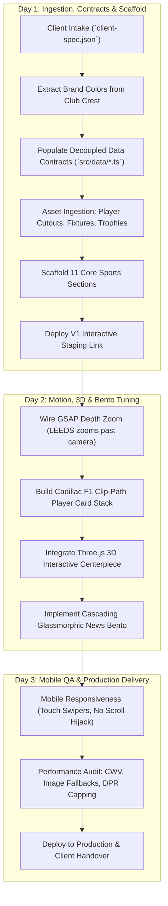

# Sports Franchise & Athletics Microsite Generator (`build-sports-franchise`)

An autonomous AI agent skill to scaffold, customize, animate, and deliver ultra-premium, high-converting sports team, motorsport racing, and athletic tournament microsites in a **3-day production turnaround cycle**.

---

## ⚡ The 3-Day Agency Delivery Blueprint

When a sports client (cricket franchise, football club, motorsport racing team, or athletic brand) requires an elite digital showcase, execute this 3-day protocol:



---

## 🏛️ Mandatory 11-Section Architecture & Flow

Every sports microsite scaffolded with this skill follows this battle-tested, high-impact section flow in `app/(site)/page.tsx`:

```
┌─────────────────────────────────────────────────────────────┐
│ 1. SportsNavbar (Transparent on Hero -> Gradient on Scroll) │
├─────────────────────────────────────────────────────────────┤
│ 2. HeroDepthScroll (GSAP Pinned Zoom, 80vh+ Disappear, Stats)│
├─────────────────────────────────────────────────────────────┤
│ 3. PlayingRosterStack (Cadillac F1 Clip-Path Player Stack)  │
├─────────────────────────────────────────────────────────────┤
│ 4. MatchdayFixtures (Horizontal Auto-Slide Track & Clock)   │
├─────────────────────────────────────────────────────────────┤
│ 5. MilestonesShowcase (Interactive Year Scrubber & Trophies)│
├─────────────────────────────────────────────────────────────┤
│ 6. NewsDispatchesBento (Cascading Semi-Transparent Glass)   │
├─────────────────────────────────────────────────────────────┤
│ 7. PointsTableStandings (Skewed High-Octane League Standings)│
├─────────────────────────────────────────────────────────────┤
│ 8. SpotlightReels (Player Lifestyle, Video Hover Previews)  │
├─────────────────────────────────────────────────────────────┤
│ 9. Sponsors3DScroll (200vh Pinned Viewport + 3D WebGL Model)│
├─────────────────────────────────────────────────────────────┤
│ 10. GalleryFullscreenScroller (Gallery Play 3-Card GSAP)    │
├─────────────────────────────────────────────────────────────┤
│ 11. ContactPartnership (Frosted Glass Lead Form + Hotline)  │
├─────────────────────────────────────────────────────────────┤
│ 12. SportsFooter (Club Crest, Legal Disclaimers, Socials)   │
└─────────────────────────────────────────────────────────────┘
```

---

## 🌟 Benchmark References & Key Takeaways

Agents implementing this archetype must study and strictly adhere to the standards of these five industry benchmarks:

### 1. [Nick Ho Motorsports](https://nickho-motorsports.nl/)
- **Key Takeaways**:
  - **Pinned Depth Hero**: GSAP ScrollTrigger pins the hero for `+=85vh`. Center typography zooms 1x &rarr; 7x with smooth scrub and disappears after 80vh+ of scroll.
  - **Architectural Grid Lines**: Vertical hairline dividers (`border-white/[0.04]`).
  - **Sponsors Depth Wall**: Central 3D element surrounded by dual vertical scrolling sponsor strips with inertia.

### 2. [Cadillac F1 Team](https://www.cadillacf1team.com/)
- **Key Takeaways**:
  - **Clip-Path Vertical Card Stacking**: Pinned roster cards reveal from bottom to top via `clipPath: inset(100% 0% 0% 0%)`.
  - **Telemetry Badges & Athlete Cutouts**: Transparent athlete images layered over subtle oversized jersey numbers (`text-[18vw] text-white/5`).

### 3. [Gallery Play](https://gallery-play.be/)
- **Key Takeaways**:
  - **Expanding Full-Screen Scroller**: 3-card photo preview expanding to 100vw &times; 100vh full-screen scroller with cinematic velocity.
  - **High-Contrast Editorial Typography**: Dramatic sports headlines with micro-badges.

### 4. [Manchester United](https://www.manutd.com/en)
- **Key Takeaways**:
  - **Matchday Fixture & Ticking Countdown**: Live countdown clock (Days, Hours, Mins, Secs) connected to next match fixture.
  - **Trophy Milestones**: Interactive timeline selector with year pills (2016, 2018, 2024) highlighting club honors.
  - **Points Table**: Distinct league standings with form pills (`W`/`L`/`D`) and home team highlight.

### 5. [The Performance Lab](https://theperformancelab.ca/)
- **Key Takeaways**:
  - **Semi-Transparent Frosted Glass Bento**: `bg-white/10 hover:bg-white/15 backdrop-blur-md border border-white/20` allowing vibrant club colors to illuminate the cards.
  - **Human Athletic Energy**: Biometric stats, bold numbers, and clean high-contrast dark mode.

---

## 🛠️ Code Recipes & Implementation Patterns

### Recipe 1: GSAP Hero Pinned Depth Zoom
```tsx
// src/components/sections/HeroSection.tsx
gsap.registerPlugin(ScrollTrigger);

const tl = gsap.timeline({
  scrollTrigger: {
    trigger: heroRef.current,
    start: "top top",
    end: () => `+=${Math.round(Math.max(window.innerHeight * 0.85, 750))}`,
    scrub: 0.6,
    pin: true,
    anticipatePin: 1,
    onLeave: () => window.dispatchEvent(new CustomEvent("hero-scrolled-change", { detail: { isPastHero: true } })),
    onEnterBack: () => window.dispatchEvent(new CustomEvent("hero-scrolled-change", { detail: { isPastHero: false } }))
  }
});

// Center Typography zooms past camera and disappears after 80vh of scroll
tl.to(centerTextRef.current, { scale: 7, ease: "power2.in", duration: 1 }, 0);
tl.to(centerTextRef.current, { opacity: 0, ease: "power1.in", duration: 0.75 }, 0.25);

// Side telemetry columns slide away during the first half of scroll
tl.to(leftColRef.current, { x: -400, opacity: 0, ease: "power2.in", duration: 0.5 }, 0);
tl.to(rightColRef.current, { x: 400, opacity: 0, ease: "power2.in", duration: 0.5 }, 0);
tl.to(bottomCardRef.current, { y: 180, opacity: 0, ease: "power2.in", duration: 0.5 }, 0);
```

### Recipe 2: Cadillac F1 Clip-Path Player Stack
```tsx
// src/components/sections/Playing11Section.tsx
// Desktop only (window.innerWidth >= 768)
const slides = slidesRef.current.filter(Boolean) as HTMLDivElement[];

slides.forEach((slide, i) => {
  if (i > 0) {
    gsap.set(slide, { clipPath: "inset(100% 0% 0% 0%)", zIndex: 10 + i });
  } else {
    gsap.set(slide, { clipPath: "inset(0% 0% 0% 0%)", zIndex: 10 });
  }
});

const tl = gsap.timeline({
  scrollTrigger: {
    trigger: containerRef.current,
    start: "top top",
    end: () => `+=${slides.length * 100}%`,
    pin: true,
    scrub: 0.8,
  }
});

slides.forEach((slide, i) => {
  if (i > 0) {
    tl.to(slide, {
      clipPath: "inset(0% 0% 0% 0%)",
      ease: "none",
      duration: 1
    }, i - 1);
  }
});
```

### Recipe 3: Bento Grid Cascading Domino Slide
```tsx
// src/components/sections/NewsSection.tsx
// Fixed-slot wrappers prevent CSS grid collapse
<div className="grid grid-cols-1 md:grid-cols-3 gap-3 w-full">
  {slots.map((slot, i) => (
    <div key={i} className={`relative overflow-hidden rounded-2xl ${slot.isWide ? "md:col-span-2" : "col-span-1"}`}>
      <AnimatePresence mode="wait" custom={direction}>
        <BentoCard key={activeArticles[i].id} article={activeArticles[i]} isWide={slot.isWide} direction={direction} />
      </AnimatePresence>
    </div>
  ))}
</div>

// Cascading Next Handler:
const handleNext = () => {
  if (isAnimating) return;
  setIsAnimating(true);
  setDirection(1);

  const nextBase = (baseIndex + 1) % newsArticles.length;
  setBaseIndex(nextBase);

  // Staggered sequential update: Slot 0 -> 1 -> 2 -> 3
  [0, 80, 160, 240].forEach((delay, slot) => {
    setTimeout(() => {
      setActiveArticles(prev => {
        const next = [...prev];
        next[slot] = getArticleAt(nextBase + slot);
        return next;
      });
    }, delay);
  });

  setTimeout(() => setIsAnimating(false), 560);
};
```

### Recipe 4: Interactive Three.js 3D Scroll Model
```tsx
// src/components/3d/CricketBall3D.tsx or SportsModel3D.tsx
useEffect(() => {
  if (!meshRef.current) return;
  // Rotate around Y and subtle wobble around X bound directly to scroll progress
  meshRef.current.rotation.y = scrollProgress * Math.PI * 4;
  meshRef.current.rotation.x = Math.sin(scrollProgress * Math.PI * 2) * 0.35;
}, [scrollProgress]);
```

---

## 🎨 Design Tokens & Theming

- **Background Void**: `#070A12` / `#0A0E1A`
- **Primary Energy**: Vibrant Club Gradient (e.g., `#FF4E03` Sunrisers Orange, `#E10600` Racing Red, `#0047AB` Cobalt)
- **Glassmorphic Cards**: `bg-white/10 hover:bg-white/15 backdrop-blur-md border border-white/20 hover:border-white/40 shadow-[0_8px_32px_rgba(0,0,0,0.12)]`
- **Highlight Gold**: `#FFCB05`
- **Fonts**:
  - `font-redzone`: Condensed athletic display font for all major titles
  - `font-forma`: Modern geometric sans-serif for metadata, stats, and body copy
